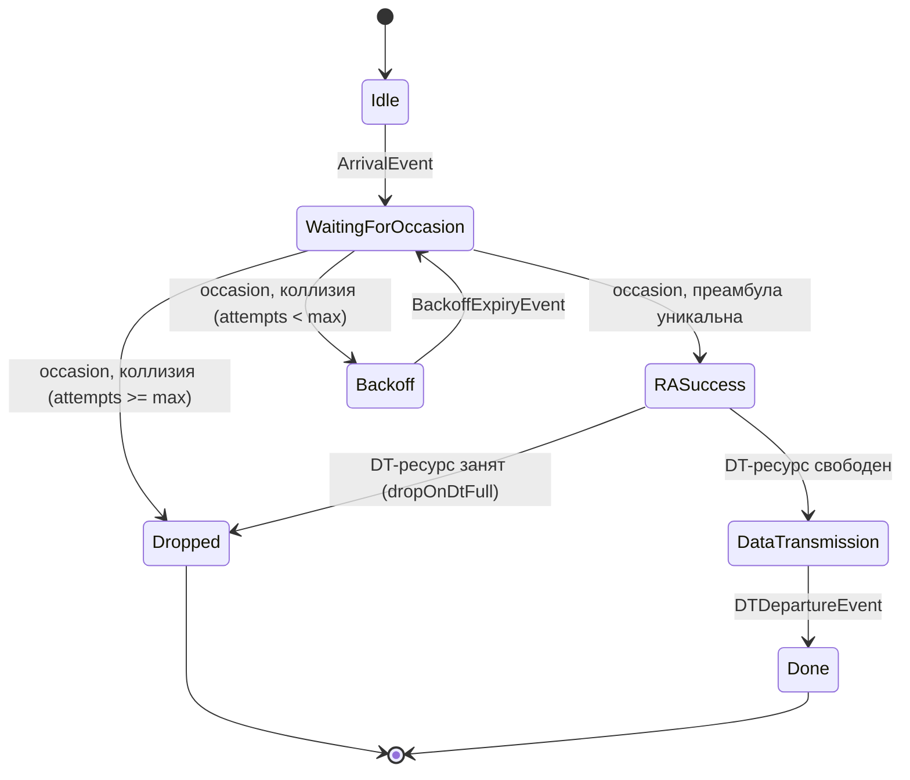

# Архитектура кода: как теория превращается в файлы

Этот документ — "карта местности": он объясняет, **где именно в коде**
живёт та или иная идея из [THEORY.md](THEORY.md), как файлы вызывают друг
друга, и — отдельным блоком — как вообще читать этот код, если вы видите
Julia в первый раз.

## Оглавление

1. [Если вы не знаете Julia: 5-минутный ликбез](#1-если-вы-не-знаете-julia-5-минутный-ликбез)
2. [Структура проекта](#2-структура-проекта)
3. [Почему все структуры данных лежат в одном файле Types.jl](#3-почему-все-структуры-данных-лежат-в-одном-файле-typesjl)
4. [Модуль 1 → Модуль 2: контракт между ними](#4-модуль-1--модуль-2-контракт-между-ними)
5. [Как работает дискретно-событийная симуляция (DES) — на пальцах](#5-как-работает-дискретно-событийная-симуляция-des--на-пальцах)
6. [Файл за файлом](#6-файл-за-файлом)
7. [Диаграмма состояний устройства](#7-диаграмма-состояний-устройства)
8. [Таблица: функция → раздел теории → тест](#8-таблица-функция--раздел-теории--тест)
9. [Как запустить](#9-как-запустить)

---

## 1. Если вы не знаете Julia: 5-минутный ликбез

Julia — язык программирования, немного похожий на Python и MATLAB одновременно.
Вот минимум, чтобы читать этот проект:

- **`struct`** — это как класс без методов, просто "коробка с полями". Пример:

  ```julia
  struct Device
      id::Int
      state::DeviceState
  end
  ```

  Значит: "у каждого `Device` есть поле `id` (целое число) и поле `state`
  (тип `DeviceState`)".

- **`mutable struct`** — то же самое, но поля можно менять после создания
  (`device.state = Done`). Обычный `struct` — "неизменяемый", после
  создания поля поменять нельзя (это специально — например,
  `NPRACHConfig` у нас `mutable`, потому что будущий Модуль 4 должен уметь
  менять параметры сети "на лету", а `ArrivalEvent` — обычный неизменяемый,
  потому что "событие в прошлом" менять не должно и не нужно).

- **`Base.@kwdef struct`** — то же самое, что `struct`, но позволяет
  создавать объект, называя поля по имени и с значениями по умолчанию:

  ```julia
  Base.@kwdef struct TrafficConfig
      kind::TrafficKind
      numDevices::Int
      reportPeriod::Float64 = 60.0   # если не указано явно — будет 60.0
  end

  cfg = TrafficConfig(kind=Periodic, numDevices=10)  # reportPeriod = 60.0 по умолчанию
  ```

- **`@enum`** — перечисление, набор именованных констант. `@enum
  TrafficKind Periodic Poisson Burst Emergency Downlink` создаёт 5 значений
  типа `TrafficKind`, которые можно сравнивать (`cfg.kind == Periodic`), но
  нельзя случайно перепутать со строкой или числом — это защита от опечаток.

- **Множественная диспетчеризация (multiple dispatch)** — вместо
  `if type == "arrival" then ... elseif type == "occasion" then ...`, в
  Julia можно определить **несколько функций с одинаковым именем**, но
  разными типами аргументов, и язык сам выберет нужную по типу:

  ```julia
  process!(state, ev::ArrivalEvent) = ...        # что делать при поступлении пакета
  process!(state, ev::NPRACHOccasionEvent) = ...  # что делать на NPRACH occasion
  process!(state, ev::BackoffExpiryEvent) = ...   # что делать когда истёк backoff
  ```

  Когда где-то в коде вызывается `process!(state, ev)`, Julia смотрит на
  **реальный тип** `ev` в этот момент и запускает нужную версию функции. Это
  заменяет собой большие цепочки `if/elseif` и делает легко добавлять новый
  тип события, не трогая существующий код — это и есть механизм, на котором
  построен весь событийный движок Модуля 2 (раздел 5 ниже).

- **`!` в конце имени функции** (например, `push_event!`, `release_dt!`) —
  это просто соглашение (не синтаксис языка): "восклицательный знак"
  предупреждает читателя, что функция **меняет** свои аргументы. Julia сама
  этого не проверяет — это как комментарий "осторожно, мутирует данные".

- **`nothing`** — это как `None` в Python или `null` в других языках:
  "здесь ничего нет". Например, `raSuccessTime::Union{Nothing,Float64}`
  значит "либо число (если устройство уже прошло RA), либо `nothing` (если
  ещё нет)".

Это всё, что нужно, чтобы дальше спокойно читать код проекта.

---

## 2. Структура проекта

```
NB-IOT/
├── Project.toml              — список зависимостей пакета NBIoTSim
├── src/
│   ├── NBIoTSim.jl           — точка входа: подключает все файлы, экспортирует имена
│   ├── Types.jl              — ВСЕ структуры данных и типы событий (см. раздел 3)
│   ├── TrafficModels.jl      — математика Модуля 1 (Model 1/2, Пуассон, периодика)
│   ├── TrafficGenerator.jl   — сборка TrafficConfig -> TrafficStream (вход Модуля 1)
│   ├── Analytics.jl          — аналитические формулы (раздел 9 THEORY.md)
│   ├── Metrics.jl            — сборщики временных рядов метрик
│   ├── EventQueue.jl         — универсальный движок дискретно-событийной симуляции
│   ├── NPRACHSimulator.jl    — RA state machine + DT-фаза (Модуль 2)
│   └── MatlabBridge.jl       — заготовка интеграции с MATLAB (Модуль 3, не реализована)
├── test/                     — 2000+ тестов, включая сверку с формулами Analytics.jl
├── examples/                 — 3 демо-скрипта с графиками (отдельное окружение, свой Project.toml)
└── docs/
    ├── TZ.md                 — техническое задание
    ├── guideMatlab.md         — справка по функциям MATLAB LTE Toolbox
    ├── THEORY.md              — теория (см. отдельно)
    ├── ARCHITECTURE.md         — этот файл
    └── GLOSSARY.md             — словарь терминов
```

---

## 3. Почему все структуры данных лежат в одном файле Types.jl

По изначальному плану предполагалось, что, например, `DTPool` будет жить в
`NPRACHSimulator.jl`, а `SimMetrics` — в `Metrics.jl`. Но в Julia **тип
должен быть объявлен раньше, чем он используется как тип поля другой
структуры**. А структура `SimState` (полное состояние симуляции) содержит
поля типа `CellConfig`, `Device`, `SimMetrics`, `DTPool` одновременно — если
раскидать эти структуры по разным файлам, включаемым по отдельности,
получился бы порочный круг (`SimState` из `EventQueue.jl` требует `DTPool` из
`NPRACHSimulator.jl`, а `NPRACHSimulator.jl` в некоторых местах требует уже
готовый `SimState`).

Решение: **все `struct`/`mutable struct`/`@enum`** живут в одном месте —
[`Types.jl`](../src/Types.jl) — а остальные файлы содержат только *функции*,
которые *оперируют* этими типами. Это стандартный и идиоматичный для Julia
подход (в отличие от, скажем, Java, где принято "один класс — один файл").
Комментарий об этом решении есть прямо в начале `Types.jl`.

---

## 4. Модуль 1 → Модуль 2: контракт между ними

Ключевая архитектурная идея — **Модуль 1 ничего не знает про NPRACH и
коллизии**, а Модуль 2 ничего не знает про то, *как именно* был получен
список поступлений — он просто получает готовый список и обрабатывает его.
Это классическое разделение ответственности: генерация нагрузки отделена от
логики её обслуживания, что позволяет:

- тестировать Модуль 1 и Модуль 2 независимо (см. `test/test_traffic_models.jl`
  vs `test/test_ra_state_machine.jl`);
- прогонять один и тот же сценарий трафика через разные конфигурации сети
  (например, сравнить `Periodicity=80` и `Periodicity=40` при одинаковой
  нагрузке — ровно то, что будет делать будущий Модуль 4);
- пакетно генерировать датасет для Модуля 3 (Этап 3 ТЗ: сценарии с разным
  числом устройств, разными нагрузками) простой сменой конфигов, без
  переписывания движка.

Формально контракт — это тип `TrafficStream` (`Types.jl`):

```julia
struct TrafficStream
    events::Vector{ArrivalEvent}            # ЧТО Модуль 1 отдаёт Модулю 2
    perDeviceKind::Dict{Int,TrafficKind}     # вспомогательно, для анализа Модуля 1 в изоляции
end
```

Функция `build_traffic_stream(cfg::TrafficConfig, simDuration) ->
TrafficStream` — **чистая функция**: при одинаковых аргументах и `seed`
всегда возвращает одинаковый результат, не имеет побочных эффектов, не
трогает глобальное состояние. Это важно для воспроизводимости научных
экспериментов (см. тест `TrafficGenerator: детерминизм при фиксированном
seed`).

```
┌─────────────────┐        TrafficStream         ┌──────────────────────┐
│    Модуль 1      │ ──────────────────────────▶ │      Модуль 2         │
│ build_traffic_    │    (Vector{ArrivalEvent},   │  run_simulation(...)   │
│ stream(cfg, T)     │     отсортирован по t)      │  -> SimState с метриками │
└─────────────────┘                              └──────────────────────┘
```

---

## 5. Как работает дискретно-событийная симуляция (DES) — на пальцах

**DES (Discrete Event Simulation)** — способ моделировать систему во
времени, не проверяя "что происходит" на каждую миллисекунду подряд (это
было бы медленно и бессмысленно — 99.9% миллисекунд вообще ничего не
происходит), а **только в моменты, когда что-то реально меняется**.

Представьте ежедневник, в котором записаны будущие дела с точным временем:
"12:03 — Событие A", "12:07 — Событие B", "12:07 — Событие C" (два дела в
одно время — тоже нормально). Алгоритм такой:

1. Посмотреть на **самую раннюю** ещё не сделанную запись.
2. "Перемотать часы" ровно до этого момента (`state.now = ev.time`).
3. Выполнить это дело. Выполнение может **дописать новые записи** в
   ежедневник (например, "после того как я отправил преамбулу и она
   столкнулась — запишу-ка я в ежедневник дело 'проверить, не истёк ли
   backoff' через 150 мс").
4. Вычеркнуть выполненную запись, вернуться к шагу 1.
5. Повторять, пока не наступит момент, превышающий длительность симуляции.

В коде этот "ежедневник" — это `state.queue`, устроенный как **бинарная
куча** (`BinaryMinHeap` из пакета `DataStructures.jl`) — структура данных,
которая умеет очень быстро отвечать на вопрос "какая запись сейчас самая
ранняя?" (за `O(log n)`, а не перебором всех записей).

- `push_event!(state, ev)` — "записать новое дело в ежедневник".
- `pop_event!(state)` — "достать самое раннее дело и вычеркнуть его".
- `step!(state)` (в [`EventQueue.jl`](../src/EventQueue.jl)) — один шаг
  алгоритма выше: достать, перемотать время, выполнить.
- `run_simulation(...)` — крутит `step!` в цикле, пока не пройдёт
  `simDuration`.

Что значит "выполнить дело"? Это вызов `process!(state, ev)` — а какая
именно логика выполнится, зависит от **типа** `ev` благодаря множественной
диспетчеризации (раздел 1). У нас 4 типа событий (все — в `Types.jl`,
`<: SimEvent` значит "является разновидностью `SimEvent`"):

| Тип события | Что произошло | Где обрабатывается |
|---|---|---|
| `ArrivalEvent` | У устройства появился пакет для передачи | `process!(::SimState, ::ArrivalEvent)` |
| `NPRACHOccasionEvent` | Наступил очередной NPRACH occasion — все ожидающие устройства выбирают преамбулы | `process!(::SimState, ::NPRACHOccasionEvent)` |
| `BackoffExpiryEvent` | У конкретного устройства истёк таймер backoff — оно снова готово пробовать | `process!(::SimState, ::BackoffExpiryEvent)` |
| `DTDepartureEvent` | Устройство закончило передачу данных, освобождает DT-ресурс | `process!(::SimState, ::DTDepartureEvent)` |

Важная деталь эффективности: чтобы на каждом `NPRACHOccasionEvent` не
перебирать *все* устройства в поисках тех, кто сейчас "ждёт" (`WaitingForOccasion`),
в `SimState` есть отдельное множество `waitingDevices::Set{Int}` —
устройство добавляется туда при `ArrivalEvent`/`BackoffExpiryEvent` и
изымается при обработке occasion'а. Это классический пример компромисса
"чуть больше состояния — намного быстрее алгоритм".

---

## 6. Файл за файлом

### `src/Types.jl`

Все структуры данных проекта (см. раздел 3). Ключевые единицы измерения
времени **обязательно** читайте в комментарии в начале файла: `TrafficConfig`
— в секундах, `NPRACHConfig`/`CellConfig`/шкала симуляции — в миллисекундах.
Здесь же — `validate_nprach_config`/`validate_cell_config`: проверки, что
параметры вписываются в реальные, разрешённые 3GPP диапазоны (раздел 5.3
[THEORY.md](THEORY.md)).

### `src/TrafficModels.jl`

Чистая математика без знания про occasion'ы и коллизии — прямая реализация
раздела 8 [THEORY.md](THEORY.md):

- `sample_activation_model1` — 3GPP TR 37.868 Model 1 (Uniform).
- `sample_activation_model2` — 3GPP TR 37.868 Model 2 (Beta(3,4)).
- `generate_periodic_device_stream` — периодический трафик одного устройства с джиттером.
- `generate_poisson_arrivals` — однородный пуассоновский процесс.
- `generate_downlink_arrivals` — нисходящий трафик, квантованный к paging cycle.

### `src/TrafficGenerator.jl`

"Клей", превращающий `TrafficConfig` в `TrafficStream` — точка входа
Модуля 1. Диспетчеризует по `cfg.kind` на нужную функцию из
`TrafficModels.jl`, конвертирует секунды в миллисекунды, присваивает каждому
поступлению **уникальный** `deviceId` (см. большой комментарий в начале
файла — это не номер физического устройства, а идентификатор конкретной
*сессии* случайного доступа; один физический периодический датчик за время
симуляции породит много таких "сессий"). Также здесь:

- `merge_streams` — объединить несколько потоков разных типов (например,
  фоновый Periodic + всплеск Emergency) в один, с перенумерацией id.
- `compute_active_devices` — считает `N_active(t)` (раздел 2.5 плана,
  разность считающих процессов "пришёл"/"ушёл").
- `estimate_intensity` — скользящее окно для `λ̂(t)`.

### `src/Analytics.jl`

Прямая реализация раздела 9–10 [THEORY.md](THEORY.md): точные формулы "шаров
по ячейкам" (`p_collision_exact`, `expected_success_exact`,
`expected_used_preambles_exact`, `expected_collided_preambles_exact`),
пуассоновское приближение/slotted ALOHA (`throughput_slotted_aloha`,
`p_empty_poisson`, `p_collision_poisson`) и формула Эрланга B (`erlang_b`).
Этот файл **не знает** про `SimState`/DES вообще — это чистая математика,
используемая только для *проверки* (в `test/`) и для *интерпретации*
результатов симуляции (в `examples/`).

### `src/Metrics.jl`

Две функции-накопители: `record_occasion_result!` (пишет в `SimMetrics`
кумулятивные счётчики успехов/коллизий и occupancy RA-ресурса после каждого
occasion'а) и `record_dt_snapshot!` (снимок загрузки DT-пула). Сама
структура `SimMetrics` — в `Types.jl`.

### `src/EventQueue.jl`

Универсальный движок DES (раздел 5): `create_sim_state`, `push_event!`/
`pop_event!`, `step!`, `run_simulation`. Не содержит **никакой** специфичной
для NB-IoT логики — теоретически на этом же движке можно было бы построить
симуляцию чего угодно другого, просто определив свои типы событий и методы
`process!`.

### `src/NPRACHSimulator.jl`

Вся специфичная для NB-IoT логика Модуля 2 — прямая реализация раздела 6
[THEORY.md](THEORY.md) (упрощённая процедура Msg1 + backoff):

- `next_occasion_time` — сетка `StartTime + k·Periodicity`.
- `select_preamble` / `assign_preambles` — случайный выбор преамбулы (раздел 5.2 THEORY.md).
- `resolve_occasion` — чистая функция разбора "кто с кем столкнулся" (раздел 9.1 THEORY.md, легко тестируется без `rng`).
- `schedule_backoff` — случайное время ожидания после коллизии.
- `try_seize_dt!` / `release_dt!` / `dt_utilization` — абстрактный пул DT-ресурса (раздел 10 THEORY.md).
- `process!` для всех 4 типов событий, плюс приватные помощники
  `_on_ra_success!`/`_on_ra_collision!` (не экспортируются из модуля, но
  доступны для тестов через полное имя `NBIoTSim._on_ra_collision!` — см.
  `test/test_ra_state_machine.jl`, где это используется для детерминированной
  проверки перехода в `Dropped` без опоры на случайность).

### `src/MatlabBridge.jl`

Пока не реализована (тело функции бросает `error(...)`) — только
зафиксированная сигнатура `to_mxstruct(cfg::NPRACHConfig) ->
Dict{String,Any}`. Задел на будущее: когда в Модуле 3 понадобится вызывать
`lteNPRACH` из MATLAB через пакет `MATLAB.jl` (интеграция Julia↔MATLAB в
ENGEE, см. `docs/guideMatlab.md`), поля `NPRACHConfig` уже названы так же,
как поля MATLAB-структуры `chs`, поэтому конвертация тривиальна.

---

## 7. Диаграмма состояний устройства



(Состояние `Transmitting` из ТЗ у нас — не отдельное хранимое состояние, а
транзиентный момент внутри обработки одного `NPRACHOccasionEvent`: все
устройства, которые "участвуют" в occasion'е, определяются множеством
`waitingDevices` непосредственно в момент обработки события, и по итогу сразу
переходят либо в `RASuccess`, либо в `Backoff`/`Dropped` — отдельного тика
"передаю преамбулу" не требуется, поскольку сама передача не моделируется
физически.)

---

## 8. Таблица: функция → раздел теории → тест

| Функция (файл) | Раздел THEORY.md | Проверяется в тесте |
|---|---|---|
| `sample_activation_model1` (TrafficModels.jl) | 8.1 | `test_traffic_models.jl` (KS-тест против Uniform) |
| `sample_activation_model2` (TrafficModels.jl) | 8.2 | `test_traffic_models.jl` (KS-тест против Beta(3,4)) |
| `generate_periodic_device_stream` / Пуассон-режим | 8.3 | `test_traffic_models.jl` (сходимость λ(t) режимов (a)/(b)) |
| `generate_downlink_arrivals` | 8.4 | `test_traffic_models.jl` (квантование к paging cycle) |
| `p_collision_exact`, `expected_success_exact` и т.д. | 9.1–9.3 | `test_collision_analytics.jl` (Монте-Карло, предельные случаи) |
| `throughput_slotted_aloha`, `p_collision_poisson` | 9.4 | `test_collision_analytics.jl` (сходимость точных формул к пуассоновским) |
| `erlang_b` | 10 | `test_collision_analytics.jl` (DES vs Erlang B, нечувствительность к закону обслуживания) |
| `next_occasion_time`, `select_preamble`, `resolve_occasion` | 5, 9.1 | `test_ra_state_machine.jl` |
| `process!` (вся RA state machine) | 6, 7 | `test_ra_state_machine.jl` (полные циклы RA) |

---

## 9. Как запустить

```bash
# Установить зависимости (один раз)
julia --project=. -e 'using Pkg; Pkg.instantiate()'

# Прогнать все тесты (должно быть "2174 passed, 0 failed")
julia --project=. -e 'using Pkg; Pkg.test()'
```

Демо-скрипты (у `examples/` своё окружение — там есть `Plots.jl`, которого
намеренно нет в зависимостях самого пакета `NBIoTSim`, чтобы библиотека
оставалась лёгкой для пакетной генерации датасета без графики):

```bash
julia --project=examples examples/run_traffic_demo.jl   # только Модуль 1
julia --project=examples examples/run_nprach_demo.jl    # только Модуль 2 + сверка с теорией
julia --project=examples examples/run_full_demo.jl      # Модуль 1 -> Модуль 2 целиком
```

Каждый скрипт сохраняет PNG-графики рядом с собой (`examples/*.png`).

Быстрый пример использования в интерактивной сессии (REPL):

```julia
using Pkg; Pkg.activate(".")
using NBIoTSim, Random

cfg = TrafficConfig(kind=Emergency, numDevices=200, activationWindow=5.0, seed=1)
stream = build_traffic_stream(cfg, 10_000.0)   # 10 секунд в мс

cellCfg = CellConfig(nprach=NPRACHConfig(NumSubcarriers=12, Periodicity=40, StartTime=8))
state = run_simulation(stream, cellCfg, 10_000.0; rng=Xoshiro(1))

state.metrics.nSuccessCum[end]     # сколько устройств прошли RA успешно
state.metrics.nCollisionsCum[end]  # сколько раз были коллизии (устройство-попытки)
```
