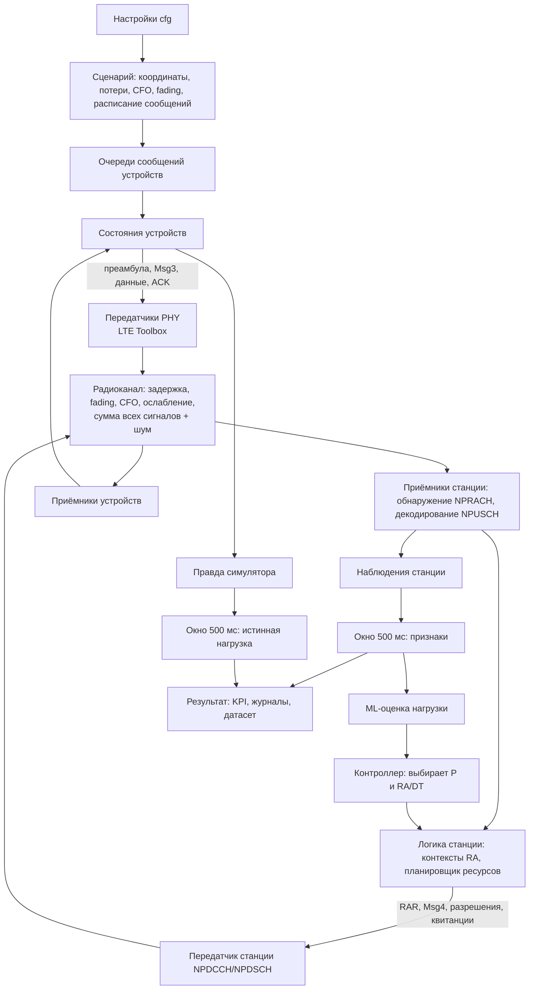
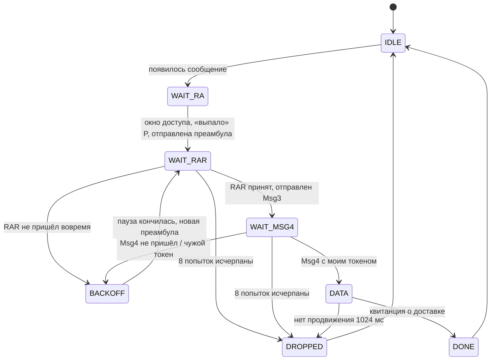

# Как устроен проект NB-IoT v4: подробное объяснение простыми словами

Этот документ написан для тех, кто плохо знаком с NB-IoT и с кодом проекта. Он объясняет:

1. что вообще моделирует проект и зачем;
2. какие термины встречаются в ТЗ, коде и интерфейсе;
3. как «живёт» одно устройство от появления сообщения до его доставки;
4. из каких модулей состоит программа и где какой файл;
5. что из ТЗ уже сделано, а что ещё нет;
6. как читать ключевые места кода (с комментариями на русском).

Документ описывает выпуск **v4.0.0** (ветка `v4`, тег `v4.0.0`). Источник требований — [ТЗ_NB-IoT_обновленный.pdf](../ТЗ_NB-IoT_обновленный.pdf), 36 страниц; номера вида «§14» ниже — это разделы ТЗ. Официальный статус выпуска — [v4-status.md](v4-status.md) и [verification/v4/validation.json](../verification/v4/validation.json); если что-то здесь расходится с ними, верны они.

---

## 1. Коротко: что это за проект

**NB-IoT** (Narrowband Internet of Things) — стандарт сотовой связи для «умных» устройств: счётчиков, датчиков, трекеров. Таких устройств очень много, каждое передаёт мало данных и редко. Проблема возникает, когда **много устройств одновременно** пытаются выйти на связь (например, после отключения электричества все счётчики разом просыпаются). Они толкаются на общем «входе» в сеть, мешают друг другу, повторяют попытки, и часть сообщений теряется.

Проект — это **имитационная модель (симулятор)** одной соты NB-IoT в MATLAB. Он:

- расставляет по кругу радиусом 1 км вокруг базовой станции заданное число устройств;
- генерирует у них сообщения (по 200 байт);
- честно моделирует, как устройства выходят на связь (процедура **случайного доступа**), как их радиосигналы проходят через эфир, складываются и смешиваются с шумом, и как базовая станция пытается эти сигналы распознать;
- моделирует передачу самих данных и проверку их целостности (CRC);
- считает показатели качества (сколько доставлено, сколько потеряно, задержки и т. д.);
- собирает данные для машинного обучения и умеет подключать «умный» контроллер, который по оценке нагрузки меняет настройки сети.

Ключевая особенность, которую требует ТЗ: модель **WAVEFORM**, то есть работа на уровне настоящих радиосигналов (комплексных отсчётов), а не по упрощённым таблицам «если сигнал сильнее на X дБ — значит принят». Формирование и приём сигналов делаются функциями **MATLAB LTE Toolbox** — это готовая библиотека MathWorks, реализующая стандарт.

**Научная цель ТЗ** (§1–4): проверить, помогают ли два адаптивных метода управления лучше обслуживать массовый доступ, чем фиксированная (статическая) настройка:

- **Adaptive-P** — регулировать вероятность, с которой устройство вообще пытается выйти на связь в данный момент («не все сразу»);
- **Adaptive-RA/DT** — перераспределять радиоресурсы между фазой входа в сеть (RA) и фазой передачи данных (DT).

---

## 2. Словарь терминов

Термины даны в том порядке, в котором они удобнее для понимания.

| Термин | Что это простыми словами |
|---|---|
| **UE** (User Equipment) | Оконечное устройство: датчик, счётчик. В коде — `ue`, `ueId`. |
| **BS / eNB** (Base Station) | Базовая станция, вышка. Одна, в центре соты. |
| **UL / DL** | Uplink — от устройства к станции; Downlink — от станции к устройству. В NB-IoT это разные частоты (FDD), сигналы UL и DL не смешиваются. |
| **Тик** | Шаг модельного времени, 1 мс. Опыт по умолчанию — 5000 тиков = 5 секунд. |
| **Отсчёт (sample)** | Одна точка цифрового радиосигнала. Частота дискретизации 1,92 МГц → 1920 отсчётов на тик. |
| **Waveform** | Радиосигнал в виде массива комплексных отсчётов. |
| **RA** (Random Access) | Случайный доступ — процедура, которой молчащее устройство «стучится» в сеть, чтобы получить разрешение передавать. |
| **NPRACH** | Физический канал случайного доступа. Сюда устройство отправляет короткий сигнал-«стук» — **преамбулу**. |
| **Преамбула, `nInit`** | Вариант «стука». В выбранной конфигурации их 12 (номера 0–11, начальный поднесущий тон). Устройство выбирает номер случайно. |
| **Окно доступа (occasion)** | Момент, когда разрешено отправить преамбулу. Здесь — каждые 80 мс, длительностью 6 мс. |
| **Msg1** | Сама преамбула (первое сообщение процедуры RA). |
| **RAR / Msg2** | Random Access Response — ответ станции: «я услышала преамбулу №N, вот тебе временный номер и место для следующего сообщения». |
| **Msg3** | Ответ устройства: «это я, вот мой уникальный идентификатор (токен)». |
| **Msg4** | Contention resolution — «разрешение конкуренции»: станция повторяет токен, который она смогла прочитать. Чей токен — тот и победил. |
| **Коллизия (логическая)** | Два или больше устройства в одном окне выбрали **одну и ту же** преамбулу. Станция видит их как одно. |
| **Физическое перекрытие** | Сигналы нескольких устройств пришли одновременно и наложились друг на друга. |
| **Capture** | Эффект «захвата»: при коллизии один сигнал сильно мощнее остальных, и станция всё же правильно принимает его. Один из столкнувшихся всё равно проходит. |
| **Near-far** | Близкое устройство «перекрикивает» дальнее. |
| **Miss** | Пропуск: устройство отправило преамбулу, а станция её не обнаружила. |
| **False alarm** | Ложная тревога: станция «увидела» преамбулу, которую никто не отправлял (шум). |
| **BACKOFF** | Пауза случайной длины перед повторной попыткой, чтобы столкнувшиеся устройства «разошлись» во времени. |
| **NPUSCH** | Канал передачи данных вверх (UL). По нему идут Msg3, пользовательские данные и короткие подтверждения (ACK). |
| **NPDCCH** | Канал управления вниз (DL). По нему станция рассылает **DCI** — короткие команды-разрешения. |
| **DCI, grant** | Downlink Control Information — команда «передавай/принимай там-то и тогда-то». Разрешение (grant) на ресурс. Формат **N0** — разрешение на передачу вверх, **N1** — на приём вниз. |
| **NPDSCH** | Канал данных вниз. По нему идут RAR, Msg4 и «квитанции» о доставке. |
| **RNTI** | Временный номер устройства в соте. **RA-RNTI** — номер, по которому устройство ищет RAR. |
| **TB** (Transport Block) | Порция данных, передаваемая за раз. Здесь 256 бит: 48 бит служебного заголовка + до 208 бит полезных. Сообщение 200 байт = 1600 бит режется на 8 TB. |
| **CRC** | Контрольная сумма. Если после приёма CRC сошёлся — блок принят без ошибок. Это главный критерий доставки в ТЗ (§20). |
| **BLER** | Block Error Rate — доля блоков, принятых с ошибкой CRC. |
| **HARQ** | Повторная передача испорченного блока с «мягким» объединением: приёмник складывает информацию из нескольких попыток. Здесь — до 4 передач одного TB. |
| **Path loss** | Ослабление сигнала с расстоянием. |
| **Shadowing** | Случайное дополнительное ослабление из-за препятствий (дома, деревья). Для каждого устройства своё. |
| **Penetration loss** | Ослабление при прохождении через стены. Устройства внутри зданий (indoor) теряют дополнительно 20 дБ. |
| **Fading** | Замирания из-за многолучевости: сигнал приходит несколькими путями, которые складываются то в плюс, то в минус. |
| **Link budget** | «Бюджет линии»: подсчёт мощности на приёме = мощность передатчика − все потери. Сравнивается с уровнем шума. |
| **SNR / SINR** | Отношение сигнал/шум; сигнал/(помехи+шум). Чем больше, тем легче принять. |
| **CFO** | Смещение несущей частоты: генераторы дешёвых устройств неточные, их сигнал слегка «уезжает» по частоте (здесь до ±200 Гц). |
| **Timing offset, TA** | Задержка прихода сигнала (из-за расстояния и неточной синхронизации). Timing Advance — поправка, которую станция сообщает устройству, чтобы оно передавало чуть раньше. |
| **Occupancy** | Занятость ресурсов: какая доля доступной «площади» частота×время реально использована. |
| **Throughput** | Пропускная способность: сколько полезных бит доставлено за секунду. |
| **KPI** | Ключевые показатели эффективности (§27). |
| **RA/DT = 10/90** | Доля ресурсов: 10 % под процедуру доступа, 90 % под передачу данных. Базовая статическая настройка ТЗ (§26). |
| **P (access probability)** | Вероятность, с которой готовое устройство отправит преамбулу в ближайшем окне. При P = 1 отправляют все готовые. |
| **Static** | Фиксированная настройка: P и RA/DT не меняются весь опыт. Точка сравнения. |
| **Ground truth, «правда»** | То, что симулятор знает точно (кто что отправил, сколько устройств реально ждёт), но что настоящая станция знать не может. |
| **Наблюдения (observed)** | То, что станция действительно может узнать сама из принятых сигналов. |
| **Seed, реализация** | Число, из которого получаются все случайные величины. Одинаковый seed и номер реализации → одинаковый опыт. |
| **Development fixture** | Тестовые данные для проверки программы. Это не научный результат. |

---

## 3. Что требует ТЗ (кратко)

ТЗ (36 стр.) описывает систему из цепочки блоков (§9):

```
Генератор трафика → Модель состояний устройства → Формирование NPRACH →
Радиоканал → Приём и анализ NPRACH → Оценка нагрузки → ML-предсказатель →
Адаптивный контроллер → Распределение ресурсов → NPDCCH/NPDSCH/NPUSCH → Метрики
```

Главные требования:

- **Сценарий** (§10): круглая сота 1000 м, устройства не ближе 10 м к станции, высоты 30 м / 1,5 м, 30 % внутри зданий, базово 1000 UE.
- **Трафик** (§11): периодический, пуассоновский и **массовый всплеск** (главный сценарий).
- **Модель состояний** (§12): IDLE → WAIT_RA → RA_TX → … → DONE или DROPPED.
- **Радиоканал** (§13): 900 МГц, полоса 180 кГц, 23 дБм, shadowing 8/10 дБ, стены 20 дБ, CFO ~ N(0, 50²) Гц в пределах ±200 Гц.
- **NPRACH на уровне сигналов** (§14–17) с коллизиями, capture, miss, false alarm.
- **Полная процедура RA** (§18–19) с BACKOFF и пределом 8 попыток.
- **NPUSCH и CRC** (§20).
- **Машинное обучение** (§21–22): датасет по окнам и четыре модели — линейная регрессия, решающее дерево, случайный лес, градиентный бустинг.
- **Контроллер** (§23) каждые 500 мс и методы **Adaptive-P** (§24) и **Adaptive-RA/DT** (§25), сравнение со **Static 10/90** (§26).
- **KPI** (§27), **методика экспериментов** с одинаковыми случайными условиями (§28), нагрузки 100–5000 UE и не менее 100 реализаций на сценарий (§29).
- **Проверки** (§31–44), **архитектура** (§45), **GUI** (§46), **структура результатов** (§47), **этапы** (§48).

---

## 4. Общая картина: как работает симулятор

### 4.1. Главная идея — «две правды»

В программе строго разделены два вида информации:

- **наблюдения базовой станции** (`observed`) — только то, что станция могла получить из реально принятых сигналов: число обнаруженных преамбул, уровни корреляции, результаты CRC, сколько разрешений она разослала;
- **правда симулятора** (`truth`) — кто на самом деле что отправил, сколько устройств ждёт, были ли коллизии.

Приёмник станции, планировщик и контроллер **не имеют доступа к правде**. Правда используется только для подсчёта показателей и как «ответ» (target) при обучении ML. Это требование §40 ТЗ: «в признаки не должно передаваться истинное количество активных UE». Без такого разделения модель «подглядывала» бы, и результаты были бы нечестными.

Аналогично устройство не узнаёт мгновенно, что станция приняла его данные. Оно узнаёт это только из следующего принятого им радиосообщения (нового разрешения или квитанции).

### 4.2. Схема потоков данных



### 4.3. Что происходит за один тик (1 мс)

Сердце программы — метод `step()` в [NBIoTSimulator.m](../src/+nbiot/NBIoTSimulator.m). Он вызывается 5000 раз. На каждом тике по порядку:

1. **Завершить приёмы**, которые к этому моменту готовы (очередь событий `receiveQueue`): станция обрабатывает окно NPRACH, декодирует Msg3/данные/ACK; устройства декодируют RAR, Msg4, разрешения и квитанции.
2. **Проверить срок жизни** сообщений (10 с) и выбросить просроченные.
3. **Проверить таймеры**: не истекло ли ожидание RAR или Msg4 (тогда BACKOFF или отказ), не «зависла» ли передача данных.
4. **Добавить новые сообщения** из заранее сгенерированного расписания в очереди устройств; устройство с сообщением переходит в `WAIT_RA`.
5. Если закончилось **окно 500 мс** — посчитать признаки и правду за окно; если включён контроллер — получить ML-оценку и принять решение.
6. Добавить в эфир **обязательные служебные сигналы** станции.
7. **Отправить преамбулы**, если сейчас окно доступа (`emitNprach`).
8. **Запланировать** ответы станции и разрешения (`schedulePending`).
9. Поставить в очередь **прослушивание** устройствами управляющего канала (`queueMonitoring`).
10. Записать размеры очередей для статистики и выбросить из памяти старые сигналы.

Важно: шаг 1 мс — это время **модели**, а не реальное. Реальный расчёт одной секунды модели с несколькими устройствами может занимать минуты, потому что каждый сигнал честно формируется и принимается.

---

## 5. Путь одного сообщения: история устройства

Возьмём одно устройство. Ниже — что с ним происходит, и в каких состояниях оно бывает.



### Шаг 1. Появляется сообщение

Расписание всех сообщений создаётся **заранее**, до начала опыта ([generateArrivals.m](../src/+nbiot/+traffic/generateArrivals.m)). В базовом сценарии «всплеск» каждое устройство получает одно сообщение в случайный момент между 1000 и 1100 мс. Сообщение — 200 случайных байт. Очередь устройства вмещает не более 10 незавершённых сообщений; лишние отбрасываются.

### Шаг 2. Попытка доступа (Msg1, преамбула)

Окна доступа идут каждые 80 мс (начиная с 8 мс), каждое длится 6 мс. В окно устройство:

- «бросает монетку» с вероятностью **P** (в Static P = 1, т. е. пробуют все);
- случайно выбирает одну из **12 преамбул**;
- формирует настоящий NPRACH-сигнал функцией LTE Toolbox (`lteNPRACH`) и отправляет его в эфир.

### Шаг 3. Эфир (радиоканал)

Каждый сигнал проходит **свой** канал ([RadioChannel.m](../src/+nbiot/+channel/RadioChannel.m)):

- ослабление (path loss + shadowing + стены);
- задержка (расстояние туда-обратно + ошибка синхронизации ±2 мкс);
- три луча с разными задержками (0; 0,3; 0,9 мкс) и случайными комплексными коэффициентами (fading Рэлея);
- сдвиг частоты (CFO).

Затем все сигналы, пришедшие на станцию, **складываются**, и добавляется тепловой шум приёмника (шум-фактор 5 дБ, 290 К). Получается то, что «услышала» антенна.

### Шаг 4. Станция ищет преамбулы

Через тик после окна станция обрабатывает принятый сигнал ([detect.m](../src/+nbiot/+phy/+nprach/detect.m)):

1. Для каждой из 12 преамбул считает **метрику** — насколько сигнал похож на неё. Если метрика выше **калиброванного порога** — это кандидат. Порог заранее подобран на шуме и помехах и хранится в [results/nprach-calibration.mat](../results/); без него опыт не запускается.
2. Для каждого кандидата уточняет задержку и CFO перебором (задержка −8…+20 мкс, CFO −200…+200 Гц с шагом 25 Гц) и проверяет совпадение по всему сигналу.
3. **Последовательно вычитает** уже найденные сильные сигналы и ищет следующий (метод последовательного подавления помех, SIC). Так слабый сигнал можно найти «под» сильным.

Станция не знает, сколько устройств передавало и кто именно. Если два устройства выбрали одну преамбулу, станция видит **одного** кандидата.

### Шаг 5. Ответ станции (RAR, Msg2)

На каждого кандидата станция создаёт **контекст** ([RaContextStore.m](../src/+nbiot/+ra/RaContextStore.m)) и планирует ответ: управляющую команду DCI N1 по NPDCCH и сам RAR по NPDSCH. В RAR: номер услышанной преамбулы, временный номер RNTI, поправка TA и разрешение на Msg3.

Устройство периодически слушает управляющий канал. Если в течение отведённого окна оно приняло RAR **со своим номером преамбулы** — идёт дальше. Если нет — **BACKOFF**.

### Шаг 6. Msg3 и разрешение конкуренции (Msg4)

Устройство отправляет по NPUSCH **Msg3** (88 бит) со своим уникальным случайным **токеном**. Если преамбулу выбрали двое, то RAR приняли оба, и оба отправляют Msg3 **на один и тот же ресурс**. Сигналы накладываются:

- если один сильно мощнее — станция может правильно декодировать его Msg3 (CRC сошёлся) — это **capture**;
- иначе CRC не сходится, и не проходит никто.

Станция отправляет **Msg4** с токеном, который смогла прочитать. Устройство, увидевшее **свой** токен, победило и отвечает коротким подтверждением (ACK, 1 бит по NPUSCH без CRC). Проигравшее не дождётся своего Msg4 и уйдёт в BACKOFF.

### Шаг 7. BACKOFF и предел попыток

При неудаче устройство ждёт случайное время от 1 до 256 мс и пробует снова. Каждая попытка увеличивает счётчик. После **8** неудачных попыток сообщение помечается как **отброшенное** (`dropped`, причина `ra_limit`).

### Шаг 8. Передача данных (NPUSCH + HARQ)

После успешного доступа станция по очереди выдаёт разрешения (DCI N0) на каждый из 8 блоков сообщения. Устройство передаёт блок по NPUSCH (3 поднесущие, 2 повтора). Станция декодирует его функциями LTE Toolbox, оценивая канал по пилотным сигналам и CFO:

- CRC сошёлся → блок принят, станция просит следующий;
- CRC не сошёлся → повтор того же блока (до 4 передач, с мягким объединением);
- 4 неудачи подряд → контекст провален.

Когда приняты все 8 блоков, сообщение считается **доставленным** (KPI доставки). Станция отправляет устройству **квитанцию**, устройство подтверждает её, освобождается и переходит к следующему сообщению.

Если за 1024 мс нет продвижения, устройство отбрасывает сообщение (`progress_timeout`).

### Шаг 9. Конец опыта

На 5000-м тике новые передачи не начинаются. Всё, что не успело завершиться, получает статус **unfinished** (незавершено). Всегда выполняется баланс: `создано = доставлено + отброшено + незавершено`.

### Соответствие состояний ТЗ и кода

ТЗ (§12) описывает 12 состояний. В коде у **устройства** состояния объединены крупнее, а этапы станции хранятся в её **контекстах**:

| ТЗ §12 | Где в коде |
|---|---|
| IDLE | `IDLE` |
| WAIT_RA | `WAIT_RA` (ждёт окна доступа) |
| RA_TX, RA_PROCESSING, WAIT_RAR | `WAIT_RAR` (преамбула отправлена, ждёт ответа; время передачи и обработки учитывается в этом же состоянии) |
| BACKOFF | `BACKOFF` |
| MSG3_TX, WAIT_CONTENTION_RESOLUTION | `WAIT_MSG4` (Msg3 отправлен, ждёт Msg4) |
| WAIT_GRANT, DATA_TX | `DATA` (ждёт разрешений и передаёт блоки) |
| DONE, DROPPED | статусы **сообщения** `delivered` / `dropped` в [PacketStore.m](../src/+nbiot/+traffic/PacketStore.m); устройство возвращается в `IDLE` |

Контекст станции проходит: `RAR_PENDING → MSG3_RX → MSG4_PENDING → MSG4_ACK → DATA_PENDING ⇄ DATA_RX → RECEIPT_PENDING → RECEIPT_ACK → DONE` (или `FAILED` / `EXPIRED`).

---

## 6. Структура папок и модулей

### 6.1. Корень проекта

| Файл | Назначение |
|---|---|
| `START.cmd`, `SAVED-100.cmd`, `CHECK.cmd` | Запуск для Windows двойным щелчком: демо, готовый отчёт на 100 устройств, проверка установки. |
| [startNBIoT.m](../startNBIoT.m) | Единая точка входа из MATLAB: проверяет версию MATLAB, LTE Toolbox, калибровку и возможность записи, затем открывает нужный режим. |
| [setupProject.m](../setupProject.m) | Добавляет папки проекта в путь MATLAB. |
| `startDemo.m`, `viewSaved100.m`, `viewDevices100.m`, `showRadioLog.m` | Старые короткие команды из v3, оставлены для совместимости. |
| `PACKAGE-MANIFEST.json` | Список всех файлов выпуска с размерами и SHA256 (проверка целостности архива). |
| `ТЗ_NB-IoT_обновленный.pdf` | Техническое задание. |

### 6.2. Исходный код `src/+nbiot/`

В MATLAB папка с `+` — это **пакет** (пространство имён). Файл `src/+nbiot/+channel/RadioChannel.m` вызывается как `nbiot.channel.RadioChannel`.

| Папка (модуль ТЗ §45) | Что делает | Главные файлы |
|---|---|---|
| `NBIoTSimulator.m` (главный объект) | Хранит всё состояние опыта и выполняет шаги времени. Связывает все модули. Методы: `run`, `step`, `stop`, `snapshot`, `result`. | [NBIoTSimulator.m](../src/+nbiot/NBIoTSimulator.m), [runExperiment.m](../src/+nbiot/runExperiment.m) |
| `+config` (Config) | Настройки по умолчанию и их проверка до запуска. | [defaultConfig.m](../src/+nbiot/+config/defaultConfig.m), [validateConfig.m](../src/+nbiot/+config/validateConfig.m) |
| `+scenario` (CellLayout) | Расставляет устройства, считает потери, CFO, задержки, коэффициенты fading, генерирует расписание сообщений. | [buildScenario.m](../src/+nbiot/+scenario/buildScenario.m) |
| `+randomness` | Независимые потоки случайных чисел для каждого источника и устройства. | [RandomSources.m](../src/+nbiot/+randomness/RandomSources.m) |
| `+traffic` (TrafficGenerator) | Генерация сообщений, очереди, нарезка на блоки и сборка. | [generateArrivals.m](../src/+nbiot/+traffic/generateArrivals.m), [PacketStore.m](../src/+nbiot/+traffic/PacketStore.m), [segmentPacket.m](../src/+nbiot/+traffic/segmentPacket.m) |
| `+devices` (Devices, StateMachine) | Таблица состояний всех устройств (без отдельного объекта на каждое — так быстрее). | [DeviceStore.m](../src/+nbiot/+devices/DeviceStore.m) |
| `+engine` | Очередь отложенных событий «приём будет готов в тик N». | [EventQueue.m](../src/+nbiot/+engine/EventQueue.m) |
| `+channel` (RadioChannel, LinkBudget) | Бюджет линии и распространение сигналов: задержка, лучи, CFO, шум, суммирование. | [evaluateLinks.m](../src/+nbiot/+channel/evaluateLinks.m), [RadioChannel.m](../src/+nbiot/+channel/RadioChannel.m), [fractionalDelay.m](../src/+nbiot/+channel/fractionalDelay.m) |
| `+phy/+nprach` (NPRACH Transmitter/Receiver) | Формирование преамбул и их обнаружение. | [buildTransmission.m](../src/+nbiot/+phy/+nprach/buildTransmission.m), [detect.m](../src/+nbiot/+phy/+nprach/detect.m), [groupMetrics.m](../src/+nbiot/+phy/+nprach/groupMetrics.m), [templates.m](../src/+nbiot/+phy/+nprach/templates.m) |
| `+phy/+npusch` (NPUSCH) | Передача и приём Msg3, данных и ACK; оценка задержки и CFO. | [buildTransmission.m](../src/+nbiot/+phy/+npusch/buildTransmission.m), [receive.m](../src/+nbiot/+phy/+npusch/receive.m), [estimateTiming.m](../src/+nbiot/+phy/+npusch/estimateTiming.m) |
| `+phy/+npdcch`, `+phy/+npdsch` (NPDCCH, NPDSCH) | Управляющие команды DCI и нисходящие данные (RAR, Msg4, квитанции). | [packDci.m](../src/+nbiot/+phy/+npdcch/packDci.m), [+npdcch/receive.m](../src/+nbiot/+phy/+npdcch/receive.m), [+npdsch/receive.m](../src/+nbiot/+phy/+npdsch/receive.m) |
| `+phy` (общее) | Таблицы профиля, обязательные служебные сигналы станции, проверка наличия Toolbox. | [ProfileTables.m](../src/+nbiot/+phy/ProfileTables.m), [buildMandatoryTransmission.m](../src/+nbiot/+phy/buildMandatoryTransmission.m), [requireToolbox.m](../src/+nbiot/+phy/requireToolbox.m) |
| `+ra` | Контексты станции для процедуры доступа, кодирование сообщений RAR/Msg3/Msg4/квитанции в биты. | [RaContextStore.m](../src/+nbiot/+ra/RaContextStore.m), [encodeMessage.m](../src/+nbiot/+ra/encodeMessage.m), [decodeMessage.m](../src/+nbiot/+ra/decodeMessage.m) |
| `+scheduler` (Scheduler) | Календарь занятости ресурсов UL/DL, квоты RA/DT, выдача разрешений. | [Scheduler.m](../src/+nbiot/+scheduler/Scheduler.m), [ResourceCalendar.m](../src/+nbiot/+scheduler/ResourceCalendar.m), [mandatoryDlMask.m](../src/+nbiot/+scheduler/mandatoryDlMask.m) |
| `+metrics` (Metrics) | Подсчёт KPI: итоговых, по окнам, по HARQ, радиодиагностики (коллизии, capture, miss, false alarm). | [summarizeKpi.m](../src/+nbiot/+metrics/summarizeKpi.m), [windowKpi.m](../src/+nbiot/+metrics/windowKpi.m), [radioDiagnostics.m](../src/+nbiot/+metrics/radioDiagnostics.m), [serviceKpi.m](../src/+nbiot/+metrics/serviceKpi.m) |
| `+dataset` (Dataset) | Формирование строк датасета по окнам 500 мс: признаки и правда отдельно; сборка датасета из многих запусков. | [featureSchema.m](../src/+nbiot/+dataset/featureSchema.m), [closeWindow.m](../src/+nbiot/+dataset/closeWindow.m), [assembleLoadDataset.m](../src/+nbiot/+dataset/assembleLoadDataset.m) |
| `+ml` (ML) | Обучение четырёх моделей, предсказание нагрузки, проверка пакета модели и её допуска. | [trainLoadModels.m](../src/+nbiot/+ml/trainLoadModels.m), [predictLoad.m](../src/+nbiot/+ml/predictLoad.m), [validateModelBundle.m](../src/+nbiot/+ml/validateModelBundle.m) |
| `+controller` (Controller, AdaptiveP, AdaptiveRADT) | Выбор действия по оценке нагрузки, подготовка контроллера к запуску. | [chooseAction.m](../src/+nbiot/+controller/chooseAction.m), [buildAdaptivePolicy.m](../src/+nbiot/+controller/buildAdaptivePolicy.m), [prepareRuntime.m](../src/+nbiot/+controller/prepareRuntime.m) |
| `+experiments` (Experiments) | Серии запусков, контрольные точки (сохранение/продолжение), бюджеты времени, учёт использованных реализаций. | [runStaticCase.m](../src/+nbiot/+experiments/runStaticCase.m), [runComparisonCase.m](../src/+nbiot/+experiments/runComparisonCase.m), [runCheckpointedExperiment.m](../src/+nbiot/+experiments/runCheckpointedExperiment.m) |
| `+results` (Results) | Сборка структуры результата, сохранение в MAT/CSV, проверка сохранённого случая. | [finalizeResult.m](../src/+nbiot/+results/finalizeResult.m), [saveResult.m](../src/+nbiot/+results/saveResult.m), [verifyCase.m](../src/+nbiot/+results/verifyCase.m), [EventLog.m](../src/+nbiot/+results/EventLog.m) |
| `+ui` (GUI) | Логика окна без самих кнопок: сессия расчёта, форматирование сводок, графики, пояснения показателей. | [SimulationSession.m](../src/+nbiot/+ui/SimulationSession.m), [formatResultSummary.m](../src/+nbiot/+ui/formatResultSummary.m), [explainMetric.m](../src/+nbiot/+ui/explainMetric.m) |
| `+util` | Перевод чисел в биты и обратно. | [toBits.m](../src/+nbiot/+util/toBits.m), [fromBits.m](../src/+nbiot/+util/fromBits.m) |

### 6.3. Остальные папки

| Папка | Что внутри |
|---|---|
| [apps/NBIoTApp.m](../apps/NBIoTApp.m) | Само окно программы (GUI). Построено программно через `uifigure`, а не в редакторе App Designer. |
| [configs/](../configs/) | Готовые наборы настроек: `baselineStatic`, `trafficPeriodic`, `trafficPoisson`, пороги контроллера `adaptiveDefaults`, параметры обучения `mlTrainingDefaults`, ограничения локальных запусков `localDevelopment` (не более 10 UE и 300 с на опыт). |
| [examples/](../examples/) | Короткие примеры: проверка среды, калибровка порога NPRACH, запуск одного устройства, базовый Static, открытие окна. |
| [experiments/](../experiments/) | Скрипты исследований: серии Static, сравнения методов, сбор датасета, обучение и «заморозка» выбора модели, исследование коллизий и capture, подготовка запуска на внешнем компьютере, итоговая приёмка. |
| [reports/](../reports/) | Готовые результаты: 1 и 100 устройств, 8 графиков PNG (см. раздел 10). |
| [results/](../results/) | Сюда сохраняются новые результаты; здесь же файл калибровки `nprach-calibration.mat`. |
| [tests/](../tests/) | 120 классов автоматических тестов `matlab.unittest` плюс тестовые заглушки и данные. |
| [verification/](../verification/) | Скрипты ограниченных проверок и сохранённые доказательства проверок разных версий. |
| [docs/](.) | Документация. История разработки сохранена; актуальное — `v4-*.md`. |

---

## 7. Подробнее по блокам

### 7.1. Настройки и их значения по умолчанию

Все настройки — одна структура `cfg` из [defaultConfig.m](../src/+nbiot/+config/defaultConfig.m). Перед запуском [validateConfig.m](../src/+nbiot/+config/validateConfig.m) проверяет их; ошибочный параметр останавливает запуск сразу, с понятным сообщением.

| Параметр | Значение | Откуда |
|---|---|---|
| Длительность / шаг | 5000 тиков по 1 мс | ТЗ §30 |
| Число UE | 1000 (в окне локально не более 10) | ТЗ §10 |
| Seed | 42 | ТЗ §30 |
| Радиус / мин. расстояние | 1000 м / 10 м | ТЗ §10 |
| Высоты BS / UE | 30 м / 1,5 м | ТЗ §10 |
| Доля indoor | 0,30 (ровно `round(0.3·N)` устройств) | ТЗ §10 |
| Несущая | 900 МГц | ТЗ §13 |
| Модель потерь | log-distance, показатель 3,5, опорное расстояние 10 м | решение проекта |
| Shadowing outdoor / indoor | σ = 8 / 10 дБ | ТЗ §13 |
| Стены (indoor) | 20 дБ | ТЗ §13 |
| Мощность UE / BS | 23 / 23 дБм | ТЗ §13 / решение |
| Шум-фактор BS / UE | 5 / 7 дБ, 290 К | ТЗ §13 / решение |
| Fading | 3 луча: 0; 0,3; 0,9 мкс; мощности 0, −3, −6 дБ; постоянны в течение опыта | решение |
| CFO | усечённая нормаль σ = 50 Гц, ±200 Гц | ТЗ §13, §17 |
| Ошибка синхронизации | равномерно ±2 мкс | решение |
| Трафик | всплеск: каждое UE — одно сообщение в 1000–1100 мс | решение |
| Размер сообщения / очередь | 200 байт / 10 | ТЗ §30 |
| Окна NPRACH | каждые 80 мс, 12 преамбул, формат 0 | решение (Release 13) |
| Макс. попыток RA / BACKOFF | 8 / до 256 мс | ТЗ §30 / решение |
| HARQ | до 4 передач, версии избыточности 0-2-0-2 | решение |
| Static | P = 1, RA/DT = 10/90 | ТЗ §26 |
| Окно датасета и контроллера | 500 мс | ТЗ §23, §30 |

Подробное обоснование каждого «решения проекта» — в [model-profile.md](model-profile.md).

### 7.2. Сценарий: расстановка устройств и бюджет линии

[buildScenario.m](../src/+nbiot/+scenario/buildScenario.m) один раз на опыт:

- ставит каждое устройство **равномерно по площади** кольца 10–1000 м (радиус берётся как `sqrt(rMin² + u·(rMax² − rMin²))`, иначе устройства скапливались бы у центра);
- случайно выбирает 30 % устройств «в зданиях»;
- считает трёхмерное расстояние до антенны и потери:

```text
PLref = 20·log10(4π·fc·dRef / c)          ≈ 51,5 дБ при 900 МГц и 10 м
PL    = PLref + 10·3,5·log10(d / dRef)     ≈ 121,5 дБ на 1000 м
L     = PL + shadowing + стены
```

- разыгрывает CFO, ошибку синхронизации и коэффициенты трёх лучей (отдельно для UL и DL);
- заранее генерирует расписание всех сообщений.

[evaluateLinks.m](../src/+nbiot/+channel/evaluateLinks.m) считает **опорный** бюджет: мощность приёма = 23 дБм − L, шум = kTF·180 кГц, SNR = разность. Это значение «до fading и помех»: оно помогает понять условия устройства, но решение о приёме принимается не по нему, а по реальному сигналу.

### 7.3. Случайность и воспроизводимость

[RandomSources.m](../src/+nbiot/+randomness/RandomSources.m) создаёт генератор `mrg32k3a` и **отдельный подпоток** для каждой комбинации «источник × направление × устройство × блок времени». Источники: расстановка, трафик, shadowing, канал, CFO, задержка, шум, содержимое сообщений, решение о доступе, BACKOFF, токен.

Зачем так сложно? Чтобы при сравнении Static и Adaptive **внешние условия были одинаковыми** (§28, §43). Если бы все брали числа из одного общего генератора, то смена политики (например, одно устройство не пошло в окно) сдвинула бы всю последовательность, и у всех остальных изменились бы шум и fading. Здесь такого не происходит: разница в результатах определяется только алгоритмом управления.

### 7.4. Радиоканал на уровне отсчётов

[RadioChannel.m](../src/+nbiot/+channel/RadioChannel.m) хранит список всех переданных сигналов. Когда приёмнику нужно окно времени, метод `receive`:

1. берёт все сигналы нужного направления, попадающие в окно;
2. каждый пропускает через фильтр дробной задержки и три луча, умножает на ослабление и поворачивает по фазе на CFO;
3. складывает их;
4. добавляет белый гауссов шум мощностью kTF·Fs.

Для NPRACH дополнительно записывается диагностика: мощность каждого сигнала, мощность помех от остальных и пары перекрытий. Эти данные — «правда»; приёмник их не видит, они нужны для отчёта о capture и near-far.

### 7.5. NPRACH: передатчик и детектор

Передатчик ([+nprach/buildTransmission.m](../src/+nbiot/+phy/+nprach/buildTransmission.m)) берёт заранее посчитанный шаблон преамбулы из [templates.m](../src/+nbiot/+phy/+nprach/templates.m) (шаблоны формируются `lteNPRACH`) и масштабирует его до 23 дБм.

Детектор описан в шаге 4 раздела 5. Его результат по каждому окну — список кандидатов с оценками задержки и CFO, плюс средняя и максимальная метрика и энергия окна. Это то, что идёт в наблюдения станции и в признаки ML.

Как в отчёте различаются исходы (это делает [radioDiagnostics.m](../src/+nbiot/+metrics/radioDiagnostics.m) по «правде»):

- **обнаружение** — номер преамбулы был отправлен и найден;
- **miss** — был отправлен, но не найден;
- **false alarm** — найден, хотя никто не отправлял;
- **логическая коллизия** — в окне 2+ устройства с одним номером;
- **capture** — среди столкнувшихся кто-то прошёл всю процедуру до Msg4, причём измерена разница мощностей.

### 7.6. Планировщик и ресурсы RA/DT

[ResourceCalendar.m](../src/+nbiot/+scheduler/ResourceCalendar.m) — «таблица бронирования» эфира: сетка UL (время × частота) и сетка DL. Из DL заранее исключены обязательные служебные подкадры станции (синхросигналы, системная информация — [mandatoryDlMask.m](../src/+nbiot/+scheduler/mandatoryDlMask.m)).

Квота **RA/DT** считается по площади «полоса × время» в каждом окне 500 мс отдельно для UL и DL. К RA относятся NPRACH, RAR, Msg3, Msg4 и их управление; к DT — блоки данных, квитанции и их управление. Заимствовать чужую квоту нельзя.

[Scheduler.m](../src/+nbiot/+scheduler/Scheduler.m) при запросе (например, «нужен RAR до такого-то срока») перебирает ближайшие окна прослушивания и варианты задержки и бронирует **сразу всю связку** — команду, полезную нагрузку и ответ — одной транзакцией. Если что-то не помещается, не бронируется ничего. Запросы обслуживаются по ближайшему сроку.

### 7.7. NPUSCH, HARQ и CRC

[+npusch/receive.m](../src/+nbiot/+phy/+npusch/receive.m) — приёмник станции. Он:

1. оценивает задержку и находит начало сигнала;
2. оценивает CFO по пилотным сигналам (DM-RS) и компенсирует его;
3. по слотам демодулирует SC-FDMA, оценивает канал (`lteULChannelEstimateNPUSCH`), декодирует (`lteNPUSCHDecode`, `lteNULSCHDecode`);
4. возвращает биты и флаг CRC. Мягкая информация сохраняется между повторами HARQ.

Короткие ACK (формат «Control») не имеют CRC, поэтому их присутствие проверяется по согласованности пилотов и повторённых бит.

### 7.8. Метрики (KPI)

Считаются в [summarizeKpi.m](../src/+nbiot/+metrics/summarizeKpi.m) и по окнам — в [windowKpi.m](../src/+nbiot/+metrics/windowKpi.m). Основные:

| KPI | Как считается |
|---|---|
| Вероятность успешного доступа | успешные попытки RA / все начатые попытки |
| Вероятность доставки | доставленные сообщения / созданные |
| Пропускная способность | доставленные полезные биты / длительность опыта |
| Вероятность коллизии | попытки, столкнувшиеся по преамбуле / все попытки |
| Вероятность потери | отброшенные / созданные |
| Задержка (средняя, 95-й процентиль) | время доставки − время создания, только по доставленным |
| Data BLER, Msg3 BLER | блоки с ошибкой CRC / все декодированные блоки |
| Occupancy UL/DL/NPRACH | занятая площадь ресурсов / доступная |
| Средняя/макс. очередь | число ожидающих сообщений во времени |
| Решения и переключения контроллера | из журнала контроллера |

Если знаменатель равен нулю, показатель — `NaN` («нет данных»), а не ноль.

### 7.9. Датасет для машинного обучения

Каждые 500 мс [closeWindow.m](../src/+nbiot/+dataset/closeWindow.m) создаёт **две строки**:

- **наблюдения** (признаки, 15 штук): число найденных кандидатов, средняя и максимальная метрика NPRACH, энергия, число декодирований и ошибок CRC на станции, сколько RAR и разрешений отправлено, средняя длина очереди запросов станции, занятость RA и DT в UL и DL, действовавшие P и RA/DT;
- **цели** (правда): `meanRaUe` — среднее число устройств, находящихся в процедуре доступа (это и есть «нагрузка», которую надо оценить), плюс вспомогательные: среднее число активных, очередь, число преамбул, число разных передававших устройств.

Список разрешённых источников признаков закреплён в [featureSchema.m](../src/+nbiot/+dataset/featureSchema.m); попытка добавить в признаки событие не из этого списка (например, результат декодирования на стороне устройства) вызывает ошибку «утечка».

Окна одного запуска не разбрасываются случайно между обучением и тестом: деление идёт **целыми реализациями** (70/15/15), иначе модель видела бы «соседей» тестовых данных.

### 7.10. ML-модели

[trainLoadModels.m](../src/+nbiot/+ml/trainLoadModels.m) обучает четыре модели из ТЗ §21 средствами Statistics and Machine Learning Toolbox:

| Модель ТЗ | Функция MATLAB |
|---|---|
| Linear Regression | `fitlm` |
| Decision Tree | `fitrtree` |
| Random Forest | `TreeBagger` (регрессия) |
| Gradient Boosting | `fitrensemble`, метод `LSBoost` |

Перед обучением пропуски заполняются медианой обучающей части, признаки нормируются (z-score) по обучающей части. Модель сохраняется «пакетом» (bundle) вместе с порядком признаков, нормировкой, списками реализаций train/validation/test и SHA256. [predictLoad.m](../src/+nbiot/+ml/predictLoad.m) проверяет, что признаки пришли в том же порядке, и выдаёт оценку; оценка вне допустимых границ помечается недействительной.

Есть строгий порядок научного допуска модели: сначала выбор только по validation, затем «заморозка» выбора ([freezeLoadModelSelection.m](../experiments/freezeLoadModelSelection.m)), и только потом однократная оценка на тесте ([evaluateFrozenLoadModels.m](../experiments/evaluateFrozenLoadModels.m)). Это защищает от подгонки под тест.

### 7.11. Контроллер, Adaptive-P и Adaptive-RA/DT

Каждые 500 мс (§23) симулятор:

1. закрывает окно и получает строку признаков;
2. передаёт её в ML-модель → оценка нагрузки;
3. [chooseAction.m](../src/+nbiot/+controller/chooseAction.m) по оценке выбирает действие **из заранее заданного набора**;
4. `applyRuntimeAction` в симуляторе проверяет действие и применяет его со следующего тика;
5. всё записывается в журнал решений (`controllerLog`).

Правила по умолчанию ([adaptiveDefaults.m](../configs/adaptiveDefaults.m)) — простые **пороги**:

**Adaptive-P** (меняется вероятность P, RA/DT остаётся 10/90):

| Оценка нагрузки (устройств в RA) | ≤ 1 | ≤ 3 | ≤ 6 | ≤ 10 | больше 10 |
|---|---|---|---|---|---|
| Вероятность P | 1,00 | 0,75 | 0,50 | 0,25 | 0,10 |

**Adaptive-RA/DT** (меняется доля ресурсов, P остаётся 1):

| Оценка нагрузки (устройств в RA) | ≤ 1 | ≤ 5 | больше 5 |
|---|---|---|---|
| RA/DT | 10/90 | 20/80 | 30/70 |

Логика: чем больше нагрузка, тем реже устройствам разрешено «стучаться» (Adaptive-P) или тем больше ресурсов отдаётся под вход в сеть (Adaptive-RA/DT). В Adaptive-P доля RA/DT остаётся 10/90; в Adaptive-RA/DT P остаётся 1.

**Важно:** эти пороги помечены как `development-provisional` — временные, для отладки. Научно обоснованные пороги требуют реальных данных и решения преподавателя.

Если модель не загружена, ошиблась или выдала недопустимое значение, контроллер **оставляет прежние настройки** и записывает причину.

### 7.12. Результаты и сохранение

`sim.result()` собирает структуру `result` (§47): настройки, сценарий (координаты и бюджет каждого UE), журналы пакетов, попыток RA, передач, декодирований и HARQ, KPI итоговые и по окнам, радиодиагностику, датасет, журнал контроллера, сведения о модели, статус и причину остановки, сведения о случайности.

[saveResult.m](../src/+nbiot/+results/saveResult.m) сохраняет:

| Файл | Содержимое |
|---|---|
| `*.mat` | полная структура `result` |
| `*_summary.csv` | одна строка итоговых KPI |
| `*_kpi.csv` | KPI по окнам 500 мс |
| `*_ue.csv` | условия и исход каждого устройства |
| `*_observations.csv`, `*_targets.csv` | датасет: признаки и правда |
| `*_radio.csv` | радиодиагностика |
| `*_resources.csv` | занятость ресурсов |
| `*_groups.csv`, `*_split.csv` | группы устройств и деление реализаций |
| `case-complete.json` | контрольные суммы всех файлов случая |

### 7.13. Контрольные точки (пауза и продолжение длинных расчётов)

Симулятор умеет сохранить **всё** своё состояние между тиками (`exportCheckpointState`) и восстановиться из него (`fromCheckpointState`). Это нужно, чтобы длинный расчёт можно было прервать и продолжить без искажения результата. Тесты проверяют, что «с паузой» и «без паузы» получается одно и то же.

### 7.14. Графический интерфейс

[apps/NBIoTApp.m](../apps/NBIoTApp.m), открывается через `START.cmd` или `startNBIoT`.

- **Слева** — настройки следующего запуска по вкладкам **Сеть**, **Канал**, **Трафик**, **Контроллер**. В «Сети» выбирается режим (Static / Adaptive-P / Adaptive-RA/DT) и ML-модель.
- **Кнопки**: Запуск, Пауза, Продолжить, Остановить, Сброс, Сохранить.
- **Справа** — вкладки:
  - **Текущий запуск**: карта соты с устройствами (цвет — состояние), карточка выбранного устройства, сводка, решения контроллера, журнал радиособытий станции;
  - **Сохранённые результаты**: открытие готовых `*_kpi.csv`, таблица, график, экспорт датасета и PNG;
  - **Сравнение режимов**: чтение готовой сводки сравнения (среднее и 95 % интервал, парная разница);
  - **Графики запуска**: 8 графиков, обновляются после каждого окна 500 мс; кнопка «Что означают показатели»;
  - **Прогноз и управление**: оценка vs истинная нагрузка, P, доля RA/DT, ошибка оценки.

Расчётом управляет [SimulationSession.m](../src/+nbiot/+ui/SimulationSession.m): таймер окна время от времени просит симулятор сделать порцию шагов и показывает снимок состояния. Интерфейс **только читает** состояние и не влияет на случайные числа (§46.15, §46.17); это проверяется тестом «пауза/продолжение даёт тот же результат».

Локально интерфейс разрешает не более **10 устройств** — это защита от случайного запуска многочасового расчёта.

### 7.15. Эксперименты и проверки

- [experiments/](../experiments/) содержит скрипты серий: `runStaticSweep` (Static при разных нагрузках), `runComparisonSweep` (сравнение режимов на одинаковых реализациях), `buildLoadDataset` / `trainLoadModels` (датасет и обучение), `runCollisionStudy` / `validateCollisionCapture` / `validateNprachInterference` (физика коллизий и capture), `prepareExternalRun` (перенос тяжёлого расчёта на другой компьютер с проверкой целостности), `runFinalAcceptance` (итоговая приёмка).
- [tests/](../tests/) — автоматические тесты: от отдельных блоков (`TestLayout`, `TestLinkBudget`, `TestPhyWaveforms`, `TestCollisionCapture`, `TestScheduler`) до сквозных (`TestEndToEnd`, `TestFullAdaptiveChain`) и интерфейса (`TestNBIoTApp*`).
- Проверки выпуска запускаются ограниченными наборами через `verification/local/runBoundedChecks.ps1` (до 10 UE, до 300 с на тест, до 900 с на набор). Для v4 выбранный набор — **107 из 107 пройдено** ([validation.json](../verification/v4/validation.json)). Полная тяжёлая регрессия для v4 не запускалась.
- `experiments/realizationRegistry.json` ведёт учёт, какие номера реализаций уже использованы и для чего (обучение, тест, сравнение), чтобы одни и те же данные не попали в разные роли.

---

## 8. Как запустить

### Обычный пользователь (Windows)

1. Полностью распаковать архив выпуска.
2. Дважды щёлкнуть **START.cmd**, дождаться MATLAB.
3. В окне нажать **«Запуск»**. Настройки по умолчанию: 1 устройство, 1 сообщение 200 байт, хорошая связь, 5 с модели. Ожидаемо: доставлено 1 сообщение, 1600 полезных бит.

`SAVED-100.cmd` — открыть готовый отчёт на 100 устройств без пересчёта. `CHECK.cmd` — проверить установку. Подробности — [v4-install.md](v4-install.md).

### Из MATLAB

```matlab
startNBIoT              % окно демо
startNBIoT('saved100')  % готовый отчёт на 100 устройств
startNBIoT('check')     % проверка MATLAB, LTE Toolbox, калибровки, записи
```

### Программно, без окна

```matlab
setupProject();
cfg = nbiot.config.defaultConfig();
cfg.simulation.numUE = 5;                                   % держите малым: расчёт медленный
cfg = nbiot.experiments.loadCalibration(cfg, fullfile(pwd,'results','nprach-calibration.mat'));
result = nbiot.runExperiment(cfg);                          % строит, запускает, возвращает результат
disp(result.kpiSummary)
nbiot.results.saveResult(result, fullfile(pwd,'results','my-run'));
```

Без загруженной калибровки порога NPRACH опыт не запустится — это сделано специально.

---

## 9. Как читать результаты: пример на 100 устройств

В `reports/100-ue` лежит сохранённый опыт Static: 100 устройств, всплеск (все сообщения в одни 100 мс), 5 с модели.

| Показатель | Значение |
|---|---|
| Создано сообщений | 100 |
| Доставлено | 6 |
| Отброшено | 86 |
| Не завершено к 5 с | 8 |
| Попыток доступа | 696 |
| Успешных доступов | 23 (≈ 3,3 % попыток) |
| Попыток с коллизией по преамбуле | ≈ 71 % |
| Data BLER | ≈ 21 % |
| Средняя задержка доставленных | ≈ 3,8 с |

Как это понимать: 100 устройств одновременно ломятся в окна доступа, где всего 12 преамбул и одно окно раз в 80 мс. Большинство попыток сталкиваются; большинство устройств исчерпывают 8 попыток и сдаются. Это ровно та проблема массового доступа, ради которой ТЗ предлагает адаптивные методы. Разбор причин — в [pilot-delivery-diagnosis.md](pilot-delivery-diagnosis.md).

**Предостережение:** это один конкретный сценарий с одной реализацией. Он не является общей оценкой NB-IoT и не доказывает ничего о преимуществах Adaptive.

---

## 10. Что из ТЗ сделано, а что нет

Обозначения: ✅ реализовано и проверено в инженерном объёме; 🟡 механизм есть, но не завершён научно или есть отличия; ❌ не выполнено.

| Требование ТЗ | Статус | Комментарий |
|---|---|---|
| Сценарий размещения UE (§10, §31) | ✅ | Воспроизводим по seed, одинаков для сравниваемых режимов. |
| Трафик: periodic, Poisson, burst (§11) | ✅ | Плюс выбор активных устройств. |
| Модель состояний UE (§12, §37) | ✅🟡 | Логика полностью есть; названия состояний устройства укрупнены (см. таблицу в разделе 5). |
| Радиоканал и link budget (§13, §32) | ✅ | Модель потерь выбрана проектом; один профиль `static-v1`. |
| WAVEFORM NPRACH через LTE Toolbox (§14, §33) | ✅ | |
| Обнаружение, miss, коллизии, capture, false alarm (§15–16, §34–35) | ✅ | Отдельные исследовательские скрипты; полные серии зависимостей ещё не собраны. |
| CFO и timing offset (§17, §36) | ✅ | |
| Полная процедура RA, BACKOFF, 8 попыток (§18–19, §38) | ✅ | Физический DL для RAR и Msg4. |
| NPUSCH, CRC, BLER (§20, §39) | ✅ | С HARQ и мягким объединением. |
| Датасет (§22) | ✅🟡 | Механизм есть; большого реального датасета нет. |
| 4 ML-модели (§21, §40) | 🟡 | Обучение и проверки есть; **принятой модели на независимых данных нет**. |
| Интеллектуальный контроллер (§23, §41) | 🟡 | Работает; пороги временные. |
| Adaptive-P, Adaptive-RA/DT (§24–25) | 🟡 | Работают в коротких запусках; научно не оценены. |
| Static 10/90 (§26) | ✅ | |
| KPI (§27) | ✅🟡 | Почти все; outage — не определён в ТЗ, групповые KPI ждут уточнения групп. |
| Одинаковые внешние условия (§28, §42–43) | ✅ | Независимые потоки случайности. |
| Серии 100/500/1000/2500/5000 UE, ≥100 реализаций (§29, этап 12) | ❌ | Были только пилоты; нагрузочная серия остановлена. Нужен мощный компьютер и бюджет. |
| Сравнения Static/Adaptive-P/Adaptive-RA/DT (§26, этап 13) | ❌ | Инструменты готовы, сами сравнения не проводились. |
| Модульная архитектура (§45) | ✅ | |
| GUI (§46) | 🟡 | Почти все панели есть; локально до 10 UE; окно построено программно, не в редакторе App Designer; визуальная приёмка преподавателем не проведена. |
| Структура результата (§47) | ✅ | MAT + CSV. |
| Итоговый научный отчёт | ❌ | |

Флаги готовности в [validation.json](../verification/v4/validation.json): `engineeringCoreReady=false`, `localReady=false`, `externalExperimentComplete=false`, `scientificFinalAcceptance=false`. Они относятся к **полной приёмке ТЗ**, а не к тому, что демо работает (демо работает).

**Решения, которые ждут преподавателя** ([v4-status.md](v4-status.md)): научные пороги и выбор модели; матрица опытов и число повторов; внешний компьютер и бюджет времени; окончательный профиль и формат GUI.

---

## 11. Разбор ключевых мест кода

Ниже — короткие фрагменты реального кода с пояснениями. Комментарии на русском добавлены **только здесь**, в документе. В сами исходники `src/` они не вносились намеренно: SHA256 исходников фиксирует «вычислительную идентичность» выпуска (файл `verification/v4/source-manifest.json`, тест `TestV4Package`), и любое изменение файла, даже комментария, сломало бы эту проверку и связь с ранее сохранёнными запусками.

### 11.1. Расстановка устройства — `buildScenario.m`

```matlab
s = sources.stream('layout',0,id,0);                     % свой поток случайных чисел для этого UE
radius = sqrt(c.minDistanceM^2 + (c.radiusM^2-c.minDistanceM^2)*rand(s));  % равномерно по площади кольца
angle  = 2*pi*rand(s);                                   % случайный угол
u.distanceM = hypot(radius, c.bsHeightM-c.ueHeightM);   % 3D-расстояние до антенны
u.medianPathLossDb = ref + 10*h.pathLossExponent*log10(max(u.distanceM,h.referenceDistanceM)/h.referenceDistanceM);
sigma = h.shadowOutdoorDb;                              % 8 дБ на улице...
if u.indoor, sigma = h.shadowIndoorDb; u.penetrationDb = h.penetrationIndoorDb; end  % ...10 дБ и +20 дБ в здании
s = sources.stream('shadowing',0,id,0);
u.shadowingDb = sigma*randn(s);                          % случайное затенение
u.pathLossDb  = max(0, u.medianPathLossDb + u.shadowingDb + u.penetrationDb);  % итоговые потери
```

### 11.2. Отправка преамбул — `NBIoTSimulator.emitNprach`

```matlab
at = find([obj.occasions.startTick]==obj.currentTick,1); if isempty(at), return; end  % сейчас не окно доступа
for u = 1:numUE
    d = obj.devices.get(u);
    if ~any(strcmp(d.state,{'WAIT_RA','BACKOFF'})) || d.nextAllowedTick>obj.currentTick, continue; end
    % ^ пробуют только ждущие доступа, у которых кончилась пауза BACKOFF
    stream = obj.sources.stream('access',0,u,occasion.occasionId);
    if rand(stream) > obj.runtimeAction.accessProbability, continue; end
    % ^ «монетка» Adaptive-P: с вероятностью 1-P устройство пропускает окно
    d.nInit = floor(rand(stream)*obj.cfg.ra.numSubcarriers);   % случайная преамбула 0..11
    d.attemptNumber = d.attemptNumber+1;                        % счётчик попыток для предела 8
    d.token = obj.newToken(u,d.lifetimeAttempt);                % уникальный токен для Msg3/Msg4
    d.state = 'WAIT_RAR';                                        % теперь ждём ответ станции
    tx = nbiot.phy.nprach.buildTransmission(obj.cfg,occasion,d.nInit);  % настоящий сигнал
    obj.channel.add(tx);                                         % отправлен в эфир
    ...
end
for k = 1:numel(ids), obj.attempts(ids(k)).collision = sum(indices==indices(k))>1; end
% ^ «правда»: отметить попытки, где номер преамбулы совпал (станция этого не видит)
obj.receiveQueue.push(occasion.endTick+obj.cfg.phy.processingTicks+1,'nprach',occasion);
% ^ станция обработает окно после его окончания — даже если никто не передавал (так ловятся false alarm)
```

### 11.3. Таймеры, BACKOFF и предел попыток — `NBIoTSimulator.advanceTimers`

```matlab
if any(strcmp(d.state,{'WAIT_RAR','WAIT_MSG4'})) && obj.currentTick>=d.deadlineTick
    % ответ (RAR или Msg4) не пришёл вовремя — попытка неудачна
    if d.attemptNumber >= obj.cfg.ra.maxAttempts
        obj.packets.markTerminal(d.packetId,'dropped','ra_limit',obj.currentTick);  % 8 попыток — сдаёмся
        obj.devices.reset(u);
    else
        s = obj.sources.stream('backoff',0,u,d.lifetimeAttempt);
        d.nextAllowedTick = obj.currentTick + ceil(rand(s)*obj.cfg.ra.backoffTicks); % пауза 1..256 мс
        d.state = 'BACKOFF';
    end
elseif any(strcmp(d.state,{'DATA','WAIT_RECEIPT'})) && obj.currentTick>=d.progressDeadlineTick
    obj.packets.markTerminal(d.packetId,'dropped','progress_timeout',obj.currentTick); % передача данных «зависла»
end
```

### 11.4. Решение контроллера — `chooseAction.m`

```matlab
if strcmp(method,'Static'), action.reason='static'; return; end   % Static ничего не меняет
if ~isequal(estimate.valid,true) ...                              % нет годной оценки — не меняем
    action.reason='invalid-estimate'; return;
end
if estimate.featureWindowEndTick~=bsState.tick                    % оценка по старому окну — не меняем
    action.reason='stale-window'; return;
end
if strcmp(method,'Adaptive-P')
    action.accessProbability = selectLevel(loadEstimate, ...       % выбрать P по порогам
        policyConfig.accessLoadThresholds, policyConfig.accessProbabilityLevels);
    action.raShare = policyConfig.staticRaShare;                   % RA/DT остаётся 10/90
else  % Adaptive-RA/DT
    action.accessProbability = policyConfig.staticAccessProbability;  % P остаётся 1
    action.raShare = selectLevel(loadEstimate, ...                 % выбрать долю RA по порогам
        policyConfig.raLoadThresholds, policyConfig.raShareLevels);
end

function value=selectLevel(loadEstimate,thresholds,levels)
index = find(loadEstimate<=thresholds,1,'first');   % первый порог, который оценка не превышает
if isempty(index), index = numel(levels); end       % выше всех порогов — последний уровень
value = levels(index);
end
```

### 11.5. Признаки окна без утечки правды — `closeWindow.m`

```matlab
e = observed([observed.tick]>=first & [observed.tick]<last);   % только наблюдения станции за окно
for k = 1:numel(e)
    if ~ismember(e(k).kind, s.allowedObservationKinds)       % разрешённый список источников
        error('nbiot:dataset:Source','Unapproved observed source.');
    end
    switch e(k).kind
        case 'nprach_detection'                               % сколько преамбул нашёл детектор и насколько уверенно
            det = det + f.count; peak(end+1) = f.meanMetric; ...
        case 'phy_decode'
            if f.receiverId~=0                                % результат приёма на стороне UE станции неизвестен
                error('nbiot:dataset:Leakage','UE decoder outcome is not a BS observation.');
            end
            ...
    end
end
```

### 11.6. Главный цикл — `NBIoTSimulator.run`

```matlab
nbiot.phy.requireToolbox();                                   % без LTE Toolbox физики нет
if ~isfinite(obj.cfg.phy.nprachThreshold)                      % без калиброванного порога детектора —
    error('nbiot:phy:Calibration', ...);                      % нельзя считать KPI
end
while obj.nextTick<=untilTick && ~obj.stopRequested, obj.step(); end   % шаг за шагом по 1 мс
```

---

## 12. Куда смотреть дальше

| Если нужно… | Читать |
|---|---|
| Установить и запустить | [v4-install.md](v4-install.md), [README.md](../README.md) |
| Точный статус выпуска | [v4-status.md](v4-status.md), [validation.json](../verification/v4/validation.json) |
| Обоснование всех параметров модели | [model-profile.md](model-profile.md) |
| Исходная архитектура и формулы KPI | [architecture.md](architecture.md), [metrics-contract.md](metrics-contract.md) |
| Как пользоваться окном | [gui-guide.md](gui-guide.md) |
| Соответствие разделу §46 (GUI) | [gui-requirements-audit.md](gui-requirements-audit.md) |
| Датасет и ML | [load-dataset.md](load-dataset.md), [ml-validation.md](ml-validation.md), [model-acceptance-contract.md](model-acceptance-contract.md) |
| Адаптивное управление | [adaptive-control.md](adaptive-control.md) |
| Физика коллизий и capture | [collision-capture-validation.md](collision-capture-validation.md), [phy-report.md](phy-report.md) |
| Расчёт на внешнем компьютере | [external-runbook.md](external-runbook.md) |
| История разработки | [current-state.md](current-state.md) (исторический журнал, не текущий статус) |
